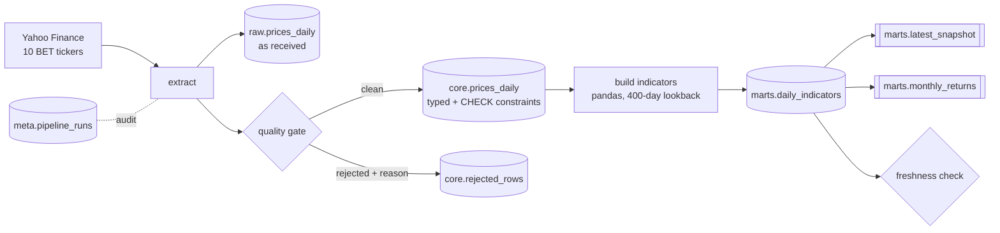

# bvb-market-data-pipeline

[](https://github.com/alexandra10zam/bvb-market-data-pipeline/actions/workflows/ci.yml)


A daily ELT pipeline for the **Bucharest Stock Exchange (BVB)**. It pulls prices for BET blue chips, runs every row through a data-quality gate, and builds analytics-ready indicator marts in PostgreSQL. Airflow orchestrates it.

It grew out of [BOT-BVB](https://github.com/alexandra10zam/BOT-BVB), a script that pinged me when a stock dropped. This project turns that idea into a proper data platform: history, quality checks, an audit trail, and alert logic as data.

## Pipeline



**Airflow DAG `bvb_daily_prices`** runs Monday to Friday at 19:30 Bucharest time, after market close:
`extract_and_validate → build_indicators → marts_freshness_check`

## Engineering decisions

| Concern | How it's handled |
|---|---|
| **Idempotency** | Every write is a bulk upsert (temp staging table + `INSERT … ON CONFLICT DO UPDATE`). Re-running any window gives identical tables, so Airflow retries and backfills are safe. This is covered by an integration test. |
| **Late data** | Each run re-fetches a 5-day window, so corrected prices overwrite old ones |
| **Data quality** | Rule-based gate (missing or non-positive prices, `high < low`, close outside the day's range, negative volume, duplicates). Bad rows go to `core.rejected_rows` with a reason and the full payload. **If over 20% of a batch is bad, the run fails** and nothing reaches `core`. |
| **Layered warehouse** | `raw` (as received) → `core` (validated, with DB `CHECK` constraints as a second line of defence) → `marts` (analytics) |
| **Observability** | `meta.pipeline_runs` records each run's window, status, row counts and errors. A freshness check fails the DAG if any ticker's data is stale. |
| **Correct scheduling semantics** | Tasks use `data_interval_end`, the trading day being closed, not `ds`, which is the interval *start* and would always lag one day |
| **Dependency isolation** | The pipeline uses SQLAlchemy 2 and Airflow 2.10 pins 1.4, so the pipeline runs in its own virtualenv inside the Airflow image |
| **Testability** | Pure functions for quality and transforms (unit tested), plus end-to-end tests on a real PostgreSQL through Testcontainers. A deterministic synthetic data source makes tests run offline. |
| **CI** | Ruff, pytest with integration tests, an Airflow `DagBag` import check against official constraints, and an image build |

## Indicators

Per ticker and day: daily return, SMA 20/50/200, 52-week high and drawdown, and 20-day annualised volatility. Two signal flags:
- `drawdown_alert`: price is below its 200-day SMA **and** at least 8% under the 52-week high (the rule from BOT-BVB)
- `golden_cross`: SMA 50 crosses above SMA 200

Sample output from a real run (`SELECT * FROM marts.latest_snapshot`, 13 Nov 2026):

| Ticker | Adj. close | Daily % | Drawdown 52w % | Volatility 20d % | Below SMA 200 | Drawdown alert |
|---|---:|---:|---:|---:|:-:|:-:|
| M.RO | 9.98 | -1.38 | -30.11 | 32.12 | yes | yes |
| BRD.RO | 32.15 | -0.46 | -17.56 | 33.08 | no | no |
| SNN.RO | 61.00 | 0.00 | -16.44 | 20.67 | yes | yes |
| TGN.RO | 87.00 | 0.00 | -12.83 | 22.34 | yes | yes |
| H2O.RO | 191.40 | -0.62 | -11.94 | 26.59 | no | no |
| TLV.RO | 37.00 | 0.00 | -2.63 | 12.96 | no | no |

*Not investment advice. This is a data engineering project.*

## Run it

**Full stack (Airflow + warehouse):**

```bash
docker compose up --build
# Airflow UI: http://localhost:8081 (user "admin", password in `docker compose logs airflow`)

# load ~3 years of history once, then let the DAG take over daily
docker compose exec airflow /opt/bvb/bin/bvb-pipeline --start 2024-01-01

# query the marts
docker compose exec warehouse psql -U bvb -d bvb -c "SELECT * FROM marts.latest_snapshot"
```

**Just the pipeline:**

```bash
python -m venv .venv && source .venv/bin/activate
pip install -e ".[dev]"
docker compose up -d warehouse
bvb-pipeline --start 2025-01-01                     # real data
bvb-pipeline --start 2025-01-01 --source synthetic   # offline, deterministic
```

**Tests:**

```bash
pytest            # unit + integration (needs Docker)
pytest -m "not integration"
```

## Layout

```
src/bvb_pipeline/
├── extract.py      Yahoo Finance + synthetic sources → tidy long format
├── quality.py      rule-based quality gate with per-row reasons
├── transform.py    rolling indicators and signal flags
├── load.py         schema bootstrap, bulk upserts, reads
├── pipeline.py     idempotent steps + run audit log
├── cli.py          `bvb-pipeline` entry point
└── sql/            warehouse DDL (schemas, constraints, views)
dags/bvb_daily.py   Airflow DAG
tests/              unit + Testcontainers integration tests
```
